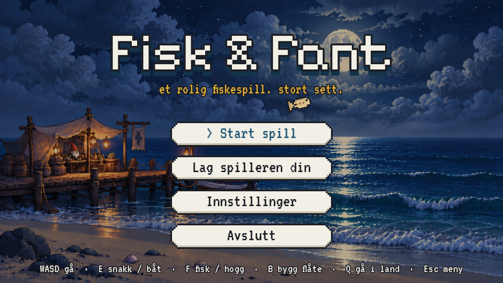

# Fisk & Fanterier 🎣

Et rolig 2D-fiskespill i pikselstil laget i Godot 4 – stort sett rolig, i alle fall.

Fisk fra brygga, selg fangsten til den gamle fiskern (som sjonglerer torsk når han kjeder seg), kjøp en tungstartet båt, hogg trær i skogen og bygg din egen flåte. Pass deg for å dette uti.

## Last ned og spill

**Spill i nettleseren:** https://broreirik.github.io/Fisk-og-Fanterier/ (fungerer best i Chrome eller Firefox på PC)

Eller gå til **[Releases](../../releases/latest)** og last ned:

| System | Fil | Slik starter du |
|---|---|---|
| Windows | `FiskOgFanterier-Windows.zip` | Pakk ut og dobbeltklikk `FiskOgFanterier.exe`. Får du «Windows beskyttet PC-en», trykk *Mer informasjon* → *Kjør likevel*. |
| Linux | `FiskOgFanterier-Linux.zip` | Pakk ut, så `chmod +x FiskOgFanterier.x86_64 && ./FiskOgFanterier.x86_64` |

Du trenger ikke installere noe annet.

## Taster

| Tast | Hva |
|---|---|
| WASD / piltaster | Gå |
| E | Snakk / kjøp / gå om bord / dra i startsnora |
| F | Fisk (og hogg trær når du har øks) |
| B | Byggemeny (flåte, teine, bål, benk) |
| Q | Gå i land |
| Tab | Inventar |
| Esc | Meny |

I båten: **W/S** er gass fram/bak og **A/D** er ror.

## Ting å gjøre

- **Fisk** makrell (5 kr), torsk (15 kr) og laks (50 kr) – trykk F når det napper!
- **Selg** fisken til fiskern på brygga.
- **Kjøp båten** (2000 kr). Den er tungstartet og fjusker litt, men den går.
- **Kjøp øks** av soldaten i skogen og **hogg trær** til tømmer.
- **Bygg en flåte** av 20 tømmer og padle rundt.
- **Lag din egen spiller** i startmenyen: genser, hår, skjegg, hudfarge og mer.
- Finn hytta langt inne i skogen 👀

## Laget av

Laget av broreirik som skoleprosjekt.
